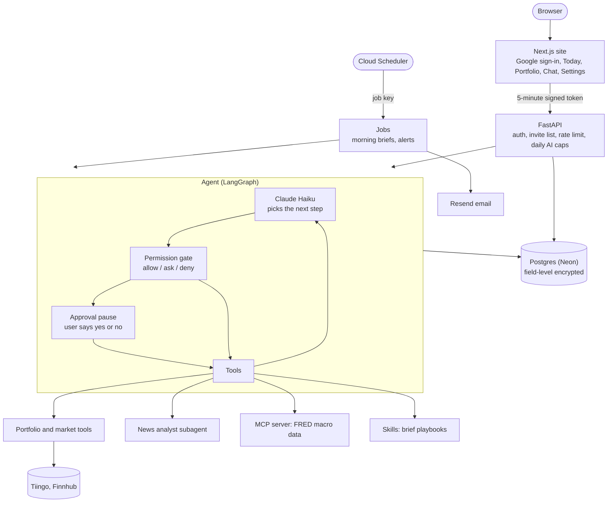

# Foxhood

**Market research, written for your portfolio.** Foxhood is an AI research assistant for a small,
invite-only group of friends. It knows what you own and what you care about, writes you a brief every
trading morning, flags what matters during the day, and answers questions about your holdings in plain
English. Live at [foxhood.app](https://foxhood.app) (invite only).

> Research only, not financial advice. Foxhood can't place trades, and the agent is blocked from trying.

## What it does
- **Today**: one sentence on how your day is going (written from the numbers, so it's instant and never
  wrong), a treemap of your holdings sized by weight and colored by today's move, your value against the
  same dollars in SPY, upcoming earnings, and this morning's brief.
- **Chat**: ask about your portfolio, a stock or the market. Answers stream in, show which tools ran, and
  cite their data sources. Anything that would change your data (watchlist, holdings, saved notes) pauses
  for your approval first.
- **Morning briefs**: written for each user at 8:30 a.m. ET on trading days and emailed if they want it.
- **Alerts**: a holding moved 5% or more, reports earnings on the next trading day, or grew past your own
  position limit. Rule-based, so they cost nothing to run.
- **Portfolio**: add purchases by shares or dollars on any past date (it finds the price you paid and handles
  splits), import broker CSVs including Fidelity's positions export, and keep a watchlist.
- **Your data**: export everything as one file, or delete your account and all of it.

## Architecture



Both apps run on **Google Cloud Run** (scale to zero). Postgres is hosted on **Neon**. Every push to `main`
that passes CI is built and deployed by GitHub Actions, using Workload Identity Federation (no stored keys).

## How it's built

| Area | What and where |
|---|---|
| Agent loop | Hand-built LangGraph `StateGraph` (`apps/api/agent/graph.py`): the model picks each tool call and when to stop; approvals use LangGraph `interrupt()` |
| Tools | Portfolio, prices, company profiles, earnings, memory (`agent/tools.py`), and write tools that always need approval (`agent/write_tools.py`) |
| Subagent | News analyst with its own prompt, tools and loop, returning validated structured output (`agent/subagents/news_analyst.py`) |
| Skills | Brief and deep-dive procedures in `skills/*/SKILL.md`, loaded on demand |
| MCP | FastMCP server for FRED economic data (`mcp_servers/macro_server.py`) via `langchain-mcp-adapters` |
| Permissions | Allow / ask / deny policy (`config/permissions.yaml`, `agent/permissions.py`), enforced before any tool runs. Trading is denied outright. See `docs/permissions.md` |
| Memory | Saved notes the agent can recall, plus conversation history in an encrypted Postgres checkpointer (`agent/checkpoint.py`) |
| Tracing | Every run, model call, tool call and permission decision is recorded per user (`agent/tracing.py`); failures investigated in `docs/failure_log.md` |
| Cost control | Per-call pricing (`agent/pricing.py`), daily caps per user and for everyone combined, one run per user at a time |
| Portfolio math | Backdated lots, split handling, price and total return against SPY (`apps/api/portfolio/`) |
| Scheduled work | Idempotent jobs for briefs and alerts (`apps/api/jobs/`), triggered by Cloud Scheduler |
| Web | Next.js 16, Auth.js (Google), a server-side proxy so the browser never talks to the API directly (`apps/web`) |

## Security and privacy
- **Invite only.** Sign-in is checked against the invite list on every request, and each email is bound to
  one Google account. Revoking an invite takes effect immediately.
- **Encrypted at rest, per field.** Holdings, notes, profiles, conversations, briefs and alerts are
  encrypted with AES-GCM before they reach the database, bound to their owner, table and row so ciphertext
  can't be copied between users. Keys live in Google Secret Manager.
- **Isolation by construction.** All data access goes through a repository bound to one verified user id;
  tests check users can't read or delete each other's data.
- **Least privilege.** Separate service accounts for the API, the site, deploys and backups, each with
  only the secrets and permissions it needs.
- **Limits.** 60 requests a minute per user, daily AI spending caps, security headers, no API docs in
  production, and no third-party tracing of user data in production.
- **Backups.** Nightly `pg_dump` to a private bucket, deleted after 30 days; restores are tested.
- What's shared with which service is on the [privacy page](https://foxhood.app/privacy).

## Data sources
Tiingo (split- and dividend-adjusted price history), Finnhub (quotes, company data, news, earnings calendar)
and FRED (economic series). Everything is cached in Postgres and shared across users, so each ticker is
fetched a few times a day at most. Details and limits: `docs/data-sources.md`.

## Running it locally

Needs Python 3.12 with [uv](https://docs.astral.sh/uv/), Node 22 with pnpm, and Postgres 16.

```bash
# API
cd apps/api
cp .env.example .env            # fill in the keys listed below
uv sync
uv run alembic upgrade head
uv run python -m app.cli invite you@gmail.com
uv run uvicorn app.main:app --reload --port 8000

# Site (second terminal)
cd apps/web
cp .env.example .env.local      # Google OAuth client, AUTH_SECRET, API_JWT_SECRET (same as the API's)
pnpm install
pnpm dev                        # http://localhost:3000
```

| Key | Where to get it |
|---|---|
| `ANTHROPIC_API_KEY` | console.anthropic.com |
| `TIINGO_API_KEY` | tiingo.com (free) |
| `FINNHUB_API_KEY` | finnhub.io (free) |
| `FRED_API_KEY` | fred.stlouisfed.org (free) |
| `FOXHOOD_DATA_KEYS` | generate: `printf 'v1:%s' "$(openssl rand -base64 32)"`, and back it up |
| `API_JWT_SECRET` | generate: `openssl rand -hex 32` |
| `RESEND_API_KEY` | resend.com (optional; without it no email is sent) |

Scheduled jobs can be run by hand: `uv run python -m jobs briefs` or `uv run python -m jobs alerts`.

## Tests
```bash
cd apps/api && uv run ruff check . && uv run pytest -q      # 107 tests, fake market data, no network
cd apps/web && pnpm lint && pnpm build
```
CI runs both on every push, against a real Postgres.

## Deploying your own
`infra/setup.sh` (registry, service accounts, secrets), `infra/deploy.sh` (build, migrate, deploy),
`infra/github-setup.sh` (deploys from GitHub Actions), `infra/scheduler.sh` and `infra/backup-setup.sh`.
Roughly $5 a month plus Claude usage, which the daily caps keep under $15.

## Repo layout
```
apps/api/    FastAPI, the agent, jobs, portfolio math, data sources, database (Alembic migrations)
apps/web/    Next.js site
infra/       Google Cloud setup and deploy scripts
docs/        Data sources, permission policy, failure log
```
